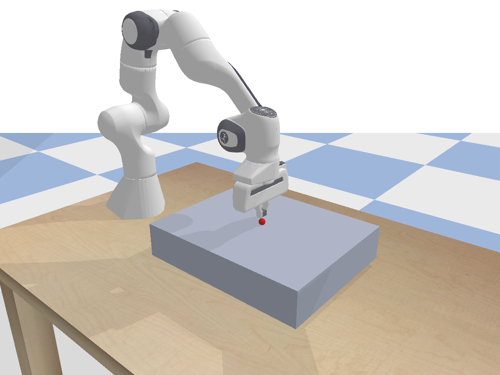
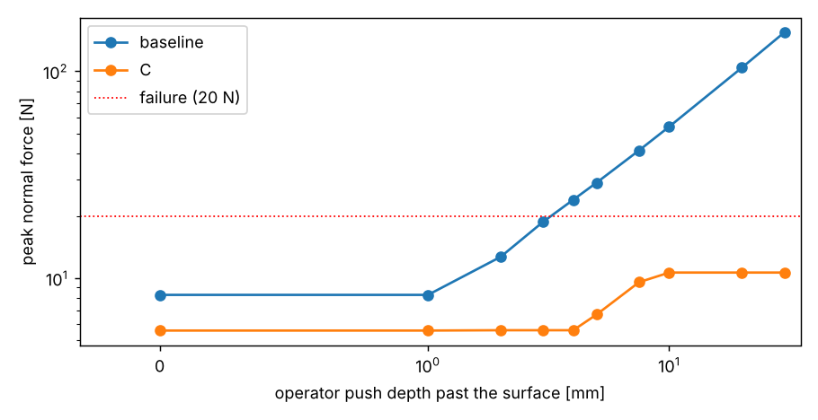

# Bilateral Teleoperation for Safe Surface-Contact Tasks

> A human guides a robot arm along a surface and feels what it feels, with the contact force kept safe: a PyBullet re-creation and extension of Pagliara et al. (2024), *Safe haptic teleoperations of admittance controlled robots with virtualization of the force feedback*.

[](https://github.com/aderinto-kfupm/bilateral-teleoperation-contact/actions/workflows/python.yml)
[](https://github.com/aderinto-kfupm/bilateral-teleoperation-contact/actions/workflows/paper.yml)

**Course:** SCE571 Robot Dynamics and Control, KFUPM · **Status:** Phase 3 (scenario + baseline + pilot) · **Language:** Python (PyBullet)
**Authors:** Sharfiden Hassen Yusuf, Mohamed Mohamedahmed, Alagie Madi Ceesay, Abdurrahman Aderinto (see [`CITATION.cff`](CITATION.cff))



## The task

A Franka Panda holds a spherical probe. The operator slides it 0.20 m along a rigid plate and must keep it
**in contact** (no gap longer than 1 s) while the normal force stays **below 20 N**. Full specification
(objects, initial conditions, task sequence, success/failure, reset): [docs/scenario.md](docs/scenario.md).

| Scenario | What the operator gets |
|---|---|
| `baseline` | direct position teleoperation, visual feedback only (no admittance, no cue) |
| `A` | admittance control, real force as the cue |
| `B` | admittance control, virtualized force cue |
| `C` | admittance + reference saturation + virtualized cue (the paper's method) |
| `X`, `Xfixed`, `Xoracle` | extension: curved surface, force tracking, estimated / fixed / true normal |

## Install (once)

Windows, with Miniconda or Anaconda. Run in an **Anaconda Prompt**:

```bat
git clone https://github.com/aderinto-kfupm/bilateral-teleoperation-contact.git
cd bilateral-teleoperation-contact
conda create -y -n franka-haptics python=3.12 pip
conda activate franka-haptics
conda install -y -c conda-forge "pybullet=3.25"
pip install "numpy==1.26.0" "matplotlib==3.9.2" pygame
```

Linux/macOS: `python3 -m venv .venv && .venv/bin/pip install -e "src/python[dev]"`, then use
`./scripts/sim.sh` wherever `scripts\sim.cmd` appears below. Details and troubleshooting: [docs/setup.md](docs/setup.md).

## Run

Every new terminal, from the repo root:

```bat
conda activate franka-haptics
set "PYTHONPATH=%CD%\src\python"
```

**Check that it works** (self-check, then scenario C in the GUI):

```bat
scripts\sim.cmd
```

**Drive it yourself** (keyboard, or a PS5 DualSense). Each trial is saved to the `--outdir` folder:

```bat
scripts\sim.cmd --scenario baseline --operator keyboard  --gui --outdir results\P01
scripts\sim.cmd --scenario C        --operator keyboard  --gui --outdir results\P01
scripts\sim.cmd --scenario C        --operator dualsense --gui --outdir results\P01
```

| Action | DualSense | Keyboard (click the PyBullet window first) |
|---|---|---|
| Move x / y | left stick | arrow keys |
| Move z (into / away from the surface) | right stick, vertical | S / W |
| Reset the trial (same scenario, initial state) | Options | R |
| End the trial and save the log | Circle | Q |
| Clutch (optional, `--clutch-button N`) | hold button N to move | -- |

A trial passes when you reach the end of the yellow line (x = 0.65 m) in contact within 25 s, with peak
force < 20 N. Ending early, never touching the surface or skipping more than 10 % of the path counts as a
failure. The window closes when the trial ends; the terminal shows the time left every 10 s. For practice
runs, `--timeout 60` gives more time, and `--hud` shows the force/cue readout (off by default, so the
baseline stays visual-only). PyBullet's own hotkeys and side panels are disabled in the GUI.
Check the pad with `python src\haptic-control\controller_test_ps5.py --list` (fixes in [docs/setup.md](docs/setup.md#6-troubleshooting)).

**Automatic operators** (no input; deterministic, so the same command gives the same numbers):

```bat
scripts\sim.cmd --scenario all --operator scripted           :: every scenario, headless, ~1 s each
scripts\sim.cmd --scenario all --operator reactive           :: operator that eases off as the cue grows
scripts\sim.cmd --scenario baseline --operator scripted --gui :: watch the baseline over-press
scripts\sim.cmd --scenario C --operator scripted --push-depth 0.01   :: push 10 mm past the surface
```

**Phase 3 pilot and figures:**

```bat
python -m teleop.pilot              :: push-depth sweep -> results\pilot_<stamp>\ (~30 s)
python -m teleop.pilot --seeds 3 --scenarios baseline A B C
python -m teleop.render             :: figures\sim_scene.png
python tests\test_controller.py     :: controller self-check only
```

Each run writes `<scenario>.csv` (full trace), `<scenario>.png` (dashboard), `summary.csv` and
`summary.json` to `results\<stamp>\` or the `--outdir` folder. All options: `python -m teleop.run --help`.
With `make` (Git Bash/Linux; Windows: `winget install ezwinports.make`): `make sim`, `make reproduce`,
`make pilot`, `make figures`, `make test`, `make lint`, `make paper` (builds `writeup/main.pdf`).

## Results so far

Scripted operator pushing 30 mm past the surface (`--scenario all --operator scripted`):

| | baseline | A | B | C | X | Xfixed | Xoracle |
|---|---|---|---|---|---|---|---|
| peak force [N] | 154.0 | 35.5 | 35.5 | **10.6** | 5.5 | 6.9 | 5.2 |
| pass | no | no | no | yes | yes | yes | yes |

Pilot (task is neither trivial nor impossible): the baseline passes only if the operator pushes at most
3 mm past the surface (peak 8.3–18.7 N) and fails from 4 mm (23.9 N); C passes at every depth from 0 to
30 mm (peak 5.6–10.6 N). With the reactive operator A, B and C pass (5.6 N) and the baseline fails.



## Phase 3 deliverables

| Deliverable | Where |
|---|---|
| Executable scenario: installation, launch, controls, reset | this README, [docs/setup.md](docs/setup.md), `scripts/sim.cmd` / `scripts/sim.sh` |
| Scenario specification (figure, initial conditions, task sequence, success/failure) | [docs/scenario.md](docs/scenario.md) |
| Baseline | `--scenario baseline` (direct Cartesian teleoperation, visual feedback only) |
| Pilot experiments | `python -m teleop.pilot`; results above and in [docs/scenario.md](docs/scenario.md#pilot-experiments-neither-trivial-nor-impossible) |

Based on Pagliara *et al.*, "Safe haptic teleoperations of admittance controlled robots with virtualization
of the force feedback," IEEE CASE 2024, doi:[10.1109/CASE59546.2024.10711457](https://doi.org/10.1109/CASE59546.2024.10711457).

## Layout

| Path | Purpose |
|---|---|
| `writeup/` (`main.tex`, `references.bib`) | The paper (IEEEtran, BibTeX). `writeup/references.bib` is the single source of citations. |
| `figures/` | Figures included by `writeup/main.tex`. Generated by code, never edited by hand. |
| `src/python/teleop/` | Control law (`controller.py`), PyBullet scene (`scene.py`), scenarios and metrics (`run.py`). |
| `src/haptic-control/` | Franka + PS5 DualSense PyBullet env (setup in its `QUICKSTART.md`). |
| `scripts/` | One-command launchers `sim.cmd` / `sim.sh`. |
| `tests/` | Controller self-checks (no PyBullet needed). |
| `data/raw/`, `data/processed/` | Inputs. Raw is read-only; large files stay out of git (see [data/README.md](data/README.md)). |
| `results/` | Generated run outputs (`results/<stamp>/*.csv`, `.png`, `summary.json`). Gitignored. |
| `papers/` | PDFs of related work for `/literature-review`. Gitignored. |
| `review/` | Literature-review output (`ver1.tex`, `ver2.tex`, ...) from `/literature-review`; verified-DOI candidate lists from `/paper-finder` in `review/consensus/`. |
| `reviews/` | In-house peer-review reports from `/academic-paper-reviewer`. See [reviews/README.md](reviews/README.md). |
| `docs/` | Onboarding, methodology, simulation guide, the Claude workflow, paper plan, submission checklist, and `phase2-report/` (the SCE571 Phase 2 report: `report.tex`/`.pdf`, original PDF, `docs/brief.txt`). |
| `.claude/skills/` | Project skills (writing, review, literature). |

## Where to start

- New here? Read [docs/onboarding.md](docs/onboarding.md).
- Want to contribute? Read [CONTRIBUTING.md](CONTRIBUTING.md).
- Writing or reviewing with the agent? Read [docs/workflow.md](docs/workflow.md).

## Citing

See [`CITATION.cff`](CITATION.cff). Code is MIT; the manuscript text and figures are CC BY 4.0 (see [LICENSE](LICENSE)).
